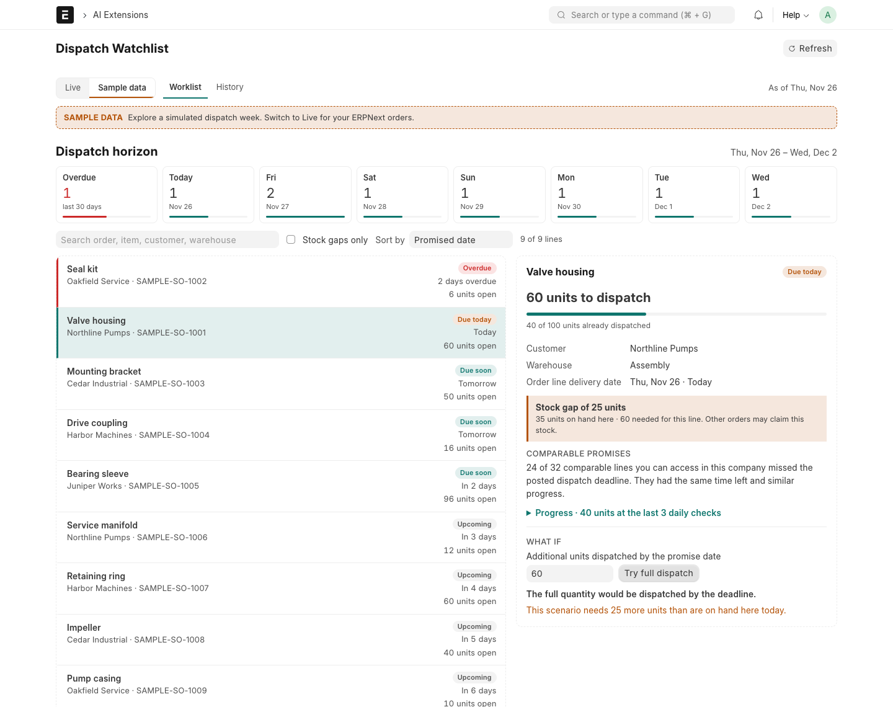
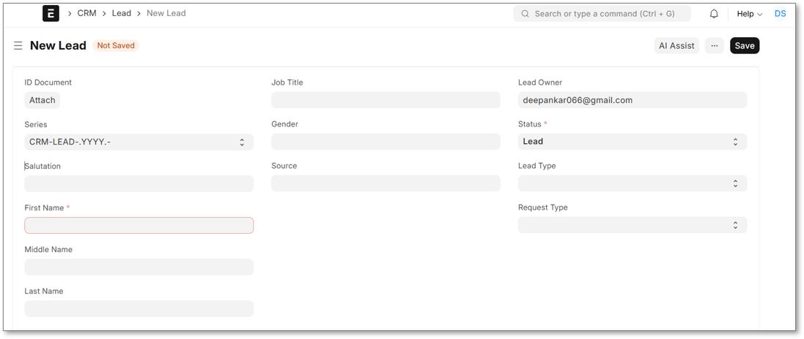
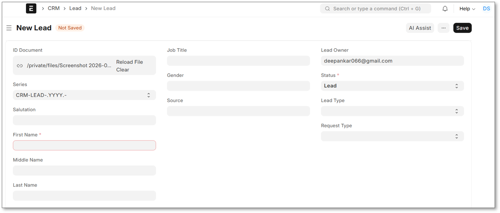
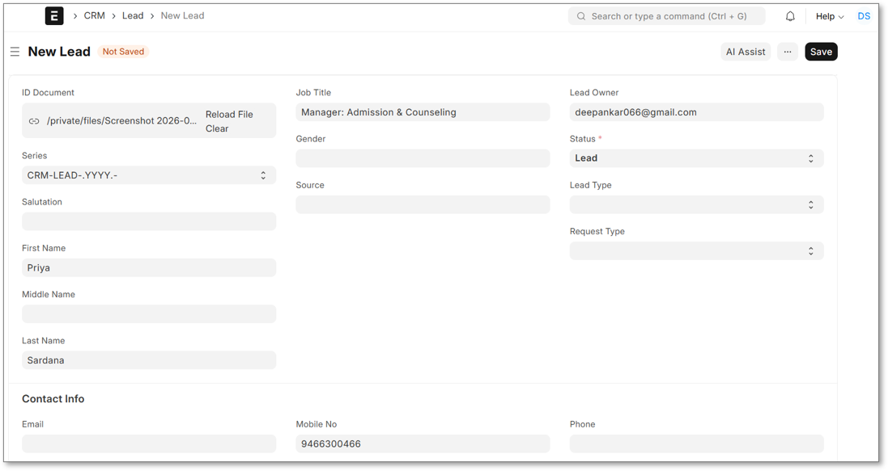

# AI Extension Framework for ERPNext

A Frappe v15 app for assigning assistants to ERPNext forms. Open **AI Extensions → AI Feature Dashboard** as a System Manager. Choose a feature and switch on a compatible module or form. Form overrides take precedence. **Use default** restores module inheritance. Open the linked form list, choose a record, then open **Actions** to use the feature.

| Assistant | Available on | What it does |
| --- | --- | --- |
| Duplicate Finder | Lead, Customer, Supplier, Item | Ranks possible matches using names and identifiers. Works before saving. |
| CRM Handoff Brief | Lead, Opportunity | Summarizes the saved stage, accessible open tasks and selected CRM note excerpts, with links to the sources. |
| Purchase Invoice Review | Purchase Invoice | Compares this invoice’s billed quantities and unit prices with explicitly linked purchase order and receipt rows. |
| Transaction Follow-up | Sales Order, Purchase Order, Delivery Note, Purchase Receipt, Sales Invoice, Purchase Invoice | Explains fulfillment, billing or payment status and shows the figures on directly linked records across Selling, Buying, Stock and Accounting. |
| Dispatch Watchlist | Sales Order | Shows upcoming dispatch commitments, warehouse stock gaps, daily progress and outcomes for comparable orders. |
| Similar Issue Finder | Issue | Searches accessible resolved and closed cases, ranks matching symptoms and shows the recorded resolution. |
| AI Chat Assistant | ERPNext document forms | Opens a demonstration chat with form context. |
| AI Form Assistant | Lead, Purchase Receipt | Extracts draft values from attachments using Azure Document Intelligence and OpenAI. |

The review, search and dispatch tools run locally. CRM Handoff Brief and Transaction Follow-up can also draft an internal note when OpenAI is configured in AI Settings. The draft button shows which evidence will be sent. The reviewer decides how to use the result.

On an order, Transaction Follow-up separates the quantity delivered or received from the amount billed and shows up to three open item rows by earliest due date. Stock documents show billing progress. Invoices show their saved payment status and balance in the party account currency. The assistant links up to three visible, submitted records of each related type. A linked invoice balance covers the whole invoice, including any other orders it bills.

Feature assignments are stored per site. New installations start with Form Assistant on its mapped forms and leave the other features available to assign. Each feature declares its compatible DocTypes in the extension catalog. Source access follows the current user’s Frappe permissions.

## Dispatch Watchlist

Open `/app/dispatch-watchlist?view=sample` on your ERPNext site to explore a simulated manufacturing week. Select **Valve housing**, expand **Progress** and choose **Try full dispatch**. The example has 60 units left to ship and 35 on hand, so it needs another 25 units to meet the promise. The scenario changes only the displayed quantities. Sample records and outcomes stay in memory.



A System Manager can turn on **Dispatch Watchlist → Selling** in the AI Feature Dashboard or enable it for **Sales Order** individually. Sales staff can then use **Actions → Dispatch Watchlist** on a saved order and choose **Open worklist**, or visit `/app/dispatch-watchlist` directly.

- **Worklist.** Open warehouse-dispatched stock lines are eligible from today through six days ahead. A separate overdue filter covers the preceding 30 days. The worklist checks up to 500 matching orders, earliest matching promise first, and shows up to 300 open lines. Search, counts and sorting cover the displayed selection.
- **Warehouse evidence.** A stock gap compares the remaining line quantity in stock units with ERPNext’s current on-hand quantity in its assigned warehouse. The calculation treats each line independently. Reservations, other open orders and future receipts can change what a dispatcher can actually ship. The stock check appears only for readable matching stock records.
- **Daily observations.** With the Frappe scheduler and long worker running, the extension checks eligible orders hourly and preserves the first observation per line, promise date and site-local day. A revised date starts a separate commitment. The progress chart shows only captured dates.
- **Outcomes.** The Sales Order line’s Delivery Date serves as its dispatch deadline. After one full calendar day for posting, the worker checks submitted Delivery Notes and stock-updating Sales Invoices linked to the original order line. A line is on time when postings dated on or before its frozen promise cover the original quantity. The recorded result reflects the ledger at assessment time. Later backdated corrections do not rewrite that observation. Changed quantities or units, returns, cancellations and unreconciled quantities can exclude a commitment.
- **Historical comparison.** A line gets a comparable miss rate when at least 20 other visible lines from the same company had the same days remaining and a similar fraction dispatched. Only outcomes known before the comparison day count. **History** replays ten selections per qualifying company-day over the past 30 days and shows how many misses each ranking would have caught. These counts describe observed orders. Their predictive value on a particular site needs live history.

## Lead extraction walkthrough

The original screenshots below show the earlier **AI Assist** button. The current entry point is **Actions → AI Form Assistant**.

## Demo Video

🎥 Watch the project demonstration here:

**Google Drive:**  
https://drive.google.com/file/d/1Xu3gFgqrpi4maC38-51Wscgai0J9Vk9-/view?usp=sharing

## Features

- AI Assist button integrated into the Lead form
- OCR-based information extraction
- Automatic Lead field population
- Modular service-oriented architecture
- Built as a custom Frappe application
- Upgrade-safe (no ERPNext core modifications)

---

# How it Works

### Step 1 - Attach the ID Document

Upload an ID document (business card, ID card, or similar document) to the **ID Document** field on the Lead form.

<p align="center">
  
</p>

---

### Step 2 - Click **AI Assist**

Click the **AI Assist** button to extract information from the uploaded document.

<p align="center">
  
</p>

---

### Step 3 - Review & Save

The extracted information is automatically populated into the Lead fields. Review the generated values and save the Lead.

<p align="center">
  
</p>
## Technology Stack

- ERPNext v15
- Frappe Framework v15
- Python
- JavaScript (Client Scripts)
- OCR

---

## Architecture

```
Lead Form
     │
     ▼
AI Assist Button
     │
     ▼
Client Script
     │
     ▼
Whitelisted API
     │
     ▼
Lead Service
     │
     ▼
File Service
     │
     ▼
OCR Service
     │
     ▼
Populate Lead Fields
```

---

## Project Structure

```
ai_lead_assistant/
├── api.py
├── hooks.py
├── public/
│   └── js/
├── services/
│   ├── lead_service.py
│   ├── file_service.py
│   └── ocr_service.py
```

---

## Future Improvements

- Duplicate Lead Detection
- AI-based Lead Scoring
- Suggested Sales Representative
- Suggested Industry & Territory
- Confidence Score for AI Predictions
- Batch Lead Creation from Multiple Documents

---

## Installation

Clone the repository into your Frappe Bench.

```bash
cd frappe-bench

bench get-app https://github.com/<your-github-username>/AI-Lead-Assistant.git

bench --site <site-name> install-app ai_lead_assistant

bench migrate
```

---

## License

This project is licensed under the MIT License.
